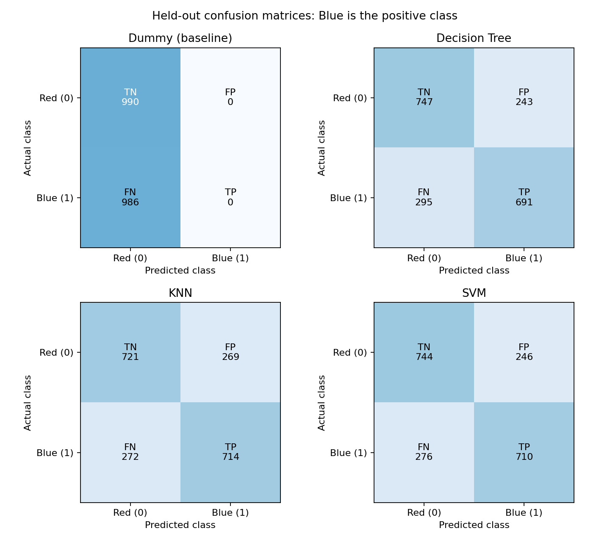
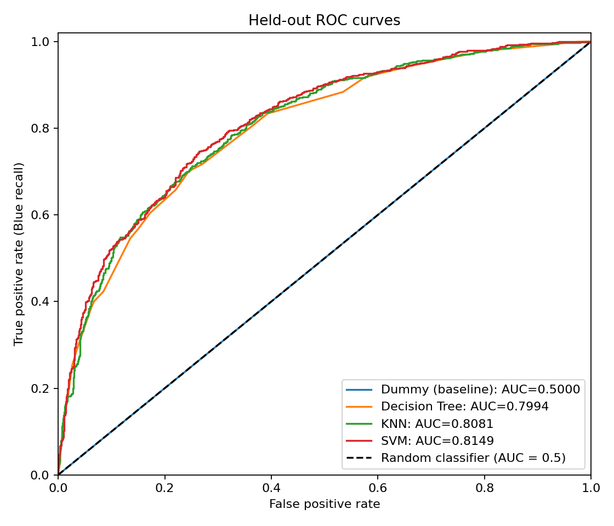
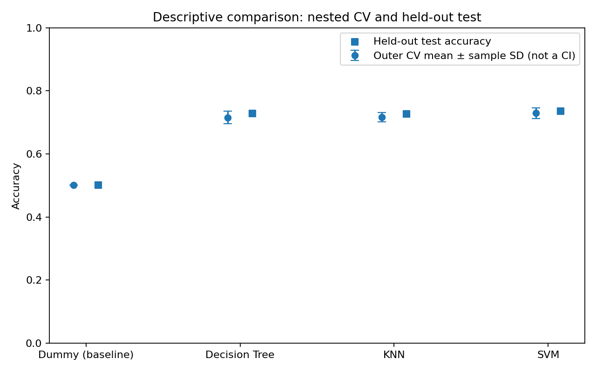
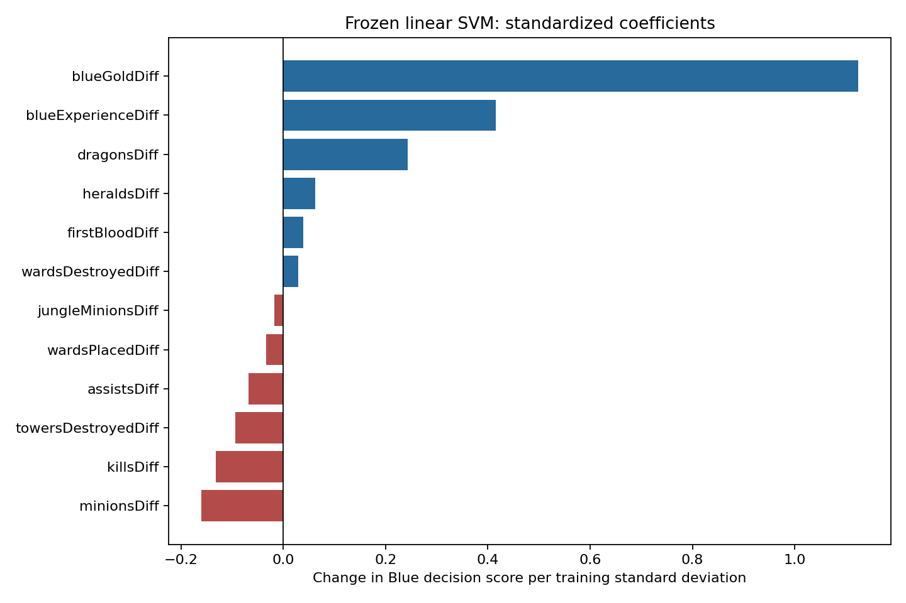

# Part C — Model Evaluation and Interpretation

**Research Question:** Can we predict the winning team in a League of Legends match using only statistics available after the first 10 minutes?

Training run: `diamond_5x3_seed42`. Dataset: original Diamond only (9,879 matches).
Positive class: `blueWins=1` (Blue wins). The SVM was selected before test evaluation.

## Verification before held-out evaluation

Source, preprocessing, split, CV membership, environment, model checksums, feature order, and saved hyperparameters passed verification. Preflight hashes the original CSV bytes but does not parse held-out feature or label values.

SVM algebra was checked on 539 artificial points. Maximum absolute score error against the saved pipeline's decision_function: 2.537e-11 in standardized coordinates and 2.537e-11 in original units. The predeclared tolerance is atol=1e-07, rtol=1e-08.

Observed public coefficient warnings: divide by zero encountered in matmul; overflow encountered in matmul; invalid value encountered in matmul.

Warnings were checked separately for SVC.coef_, NumPy matmul, and NumPy dot. The local warning is isolated to the matmul path used by SVC.coef_; a low-level library or hardware cause has not been established. Finite weights and agreement with libsvm decision_function are independently verified. Interpretation uses math.fsum, without altering the saved model or suppressing global warnings.

## Held-out evaluation

The frozen pipelines were evaluated on the original 1,976 held-out matches. No model, feature, threshold, or hyperparameter was changed.

| Model | Accuracy | Precision | Recall | F1 | ROC-AUC |
|---|---:|---:|---:|---:|---:|
| Dummy (baseline) | 0.5010 | 0.0000 | 0.0000 | 0.0000 | 0.5000 |
| Decision Tree | 0.7277 | 0.7398 | 0.7008 | 0.7198 | 0.7994 |
| KNN | 0.7262 | 0.7263 | 0.7241 | 0.7252 | 0.8081 |
| SVM | 0.7358 | 0.7427 | 0.7201 | 0.7312 | 0.8149 |

| Model | TN | FP | FN | TP |
|---|---:|---:|---:|---:|
| Dummy (baseline) | 990 | 0 | 986 | 0 |
| Decision Tree | 747 | 243 | 295 | 691 |
| KNN | 721 | 269 | 272 | 714 |
| SVM | 744 | 246 | 276 | 710 |

The preselected SVM achieves 73.58% accuracy versus 50.10% for Dummy, a difference of 23.48 percentage points. Its ROC-AUC is 0.8149. Precision is the proportion of predicted Blue wins that are correct; recall is the proportion of actual Blue wins recovered. ROC-AUC describes ranking, not calibration.

The baseline predicts Red for every match, correctly classifying 990 Red wins and missing all 986 Blue wins. Its zero Blue precision, recall, and F1 follow the stated zero-division convention. The learned models all improve on this reference.

For the SVM, 1,454 of 1,976 predictions are correct. It misses 276 Blue wins and incorrectly predicts Blue in 246 Red wins. These errors illustrate the remaining uncertainty despite above-baseline performance.

## Descriptive comparison with nested CV

| Model | Outer CV accuracy ± sample SD | Test accuracy | Test minus CV mean |
|---|---:|---:|---:|
| Dummy (baseline) | 0.5009 ± 0.0002 | 0.5010 | +0.0001 |
| Decision Tree | 0.7158 ± 0.0206 | 0.7277 | +0.0119 |
| KNN | 0.7162 ± 0.0145 | 0.7262 | +0.0100 |
| SVM | 0.7295 ± 0.0167 | 0.7358 | +0.0064 |

All five metrics are compared in cv_test_comparison.json. Outer-fold SD describes variation across five folds; it is not a confidence interval. Differences between CV and test estimates are descriptive and do not establish statistical significance.

## Answer to the Research Question

Yes, within this Diamond sample, statistics available after the first ten minutes support above-baseline prediction of the winning team. The SVM selected before test evaluation achieves 73.58% accuracy and 0.8149 ROC-AUC on 1,976 held-out matches, exceeding the majority-class baseline accuracy by 23.48 percentage points. Prediction remains imperfect; these results do not establish causal effects or reliable transfer to future patches or other player populations.

## Interpretation of the frozen linear SVM

The model is f(x) = b + sum_j w_j (x_j - training_mean_j) / training_scale_j. Positive coefficients increase the Blue decision score, holding other features fixed. Absolute standardized coefficients describe sensitivity per training standard deviation. Original-unit coefficients are w_j / training_scale_j; the intercept is adjusted for centering. These quantities are neither probabilities nor causal effects.

The three largest absolute standardized coefficients in the saved model are `blueGoldDiff` (+1.1238), `blueExperienceDiff` (+0.4151), `dragonsDiff` (+0.2432). This describes the fitted decision function rather than test performance.

Negative coefficients for some combat, farming, or tower differences must be read conditionally on the other retained predictors. They do not show that obtaining kills, minions, or towers harms a team's chances of winning. Strong correlations make isolated coefficient interpretations particularly fragile.

| Feature | Standardized coefficient |
|---|---:|
| blueGoldDiff | +1.123845 |
| blueExperienceDiff | +0.415138 |
| dragonsDiff | +0.243173 |
| minionsDiff | -0.159640 |
| killsDiff | -0.131435 |
| towersDestroyedDiff | -0.093446 |
| assistsDiff | -0.067275 |
| heraldsDiff | +0.062119 |
| firstBloodDiff | +0.038807 |
| wardsPlacedDiff | -0.032965 |
| wardsDestroyedDiff | +0.029403 |
| jungleMinionsDiff | -0.017638 |

## Methodological limitations

- The random split assesses this Diamond sample; player overlap cannot be excluded because player IDs are unavailable.
- Patch, collection date, and region are unknown. No temporal, regional, or cross-rank validation is established.
- Correlated gold, experience, kills, and assists can redistribute coefficient magnitudes and signs.
- Suspicious ward counts were retained. Relative differences omit absolute game tempo and some tied objective states.
- Model-family selection uses CV and can introduce selection optimism. Five-fold SD is not a confidence interval.
- C=10 and k=81 are at search-grid boundaries; the test cannot justify expanding those grids.
- The SVM is uncalibrated. Its margins are not individual win probabilities.
- No test result may reopen model selection, tuning, feature engineering, or threshold optimization.

## Reproduction and evidence

The final workflow completed successfully and must not be rerun for inference. Full-precision metrics, confusion counts, ROC coordinates, and CV comparisons are saved in `model_evaluation/diamond_5x3_seed42/`. Tables round metrics to four decimal places; the source JSON and CSV retain full precision. Individual predictions remain in the local ignored data directory. Rendering and notebook execution reuse these outputs.
